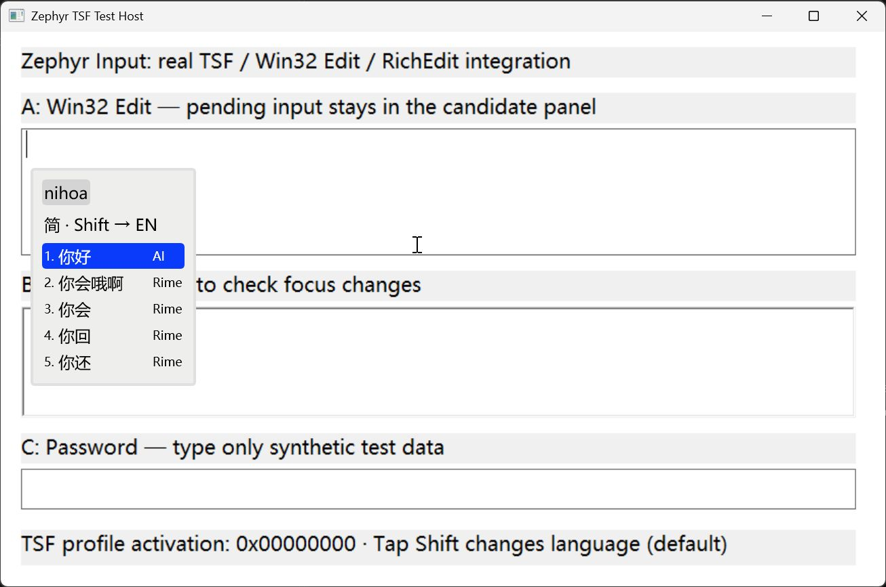

# Zephyr Input · 微风输入法

[下载 Windows 版](dist/Zephyr-Input-Windows-1.6.3-Setup-x64.exe) · [下载 Android 版](dist/Zephyr-Input-1.5.3-arm64-v8a-demo.apk) · [GPL-3.0-or-later](LICENSE)

我想要一个打字快、隐私设置清楚、也能看懂手滑拼音的输入法，于是做了 Zephyr，自己日常用。欢迎来当小白鼠，遇到问题提个 Issue 就好。

**目前还是原型，请谨慎使用。** 虽然我已经在日常使用，但还有不少地方要打磨。已精简提示词和候选输出，但长输入和模型思考的 token 消耗仍可能比较大，建议先用小型模型试试。我用 Luna 和 Qwen3.8 27B 测下来效果还不错。

Zephyr 是基于 **Rime** 的中文拼音输入法，目前有 **Windows 和 Android** 两个版本。离线用雾凇词库，联网后调用 **在线 LLM API**，通过提示词补足词库匹配：修正漏输、重复、错序和邻键误触，处理长拼音和中英文混输，也可以按描述生成颜表情。

中文模式下，拼音转汉字，英语保留并纠错；英文模式下，优先纠正英语，把中文、拼音或混输转成英文。两种模式都有候选区，每次请求返回一个 AI 候选，由你选中上屏。

云端支持 **OpenAI、OpenRouter 和 Google Gemini**。可以把接口、Key、模型和参数保存成多个 Policy 随时切换；OpenRouter 还支持供应商路由和后台 Preset 提示词。纠错能有多强、等待有多短，取决于模型的能力，以及你的钱包（笑）。

**LLM 功能需要联网，模型在 OpenAI、OpenRouter 或 Google Gemini 的远程服务端运行，不在手机或电脑本地运行。** 离线输入使用 Rime 和本地词库。开启云端 AI 后，当前输入会发送给所选 API 服务，Key 加密保存在设备上。

### English

I built Zephyr for my own daily typing: fast pinyin input, clear privacy controls, and some tolerance for clumsy fingers. You're welcome to be a guinea pig too—open an issue when something feels off.

**This is still a prototype; please use it with care.** I use it daily, but there is plenty left to improve. Prompts and output are now shorter, but long input and model reasoning can still use plenty of tokens. Start with a smaller model; Luna and Qwen3.8 27B have worked fairly well in my own testing.

**Zephyr Input** is a **Rime-based pinyin keyboard for Windows and Android**. It uses Rime Ice dictionaries offline and calls **online LLM APIs** for missing letters, repeated characters, swapped letters, nearby-key mistakes, long pinyin, and mixed Chinese–English input. It can also turn a short description into a kaomoji.

Chinese mode converts pinyin to Chinese while keeping and correcting English. English mode corrects English and translates Chinese, pinyin, or mixed input into English. Both modes show candidates; each AI request returns one suggestion for you to select.

Cloud assistance supports **OpenAI, OpenRouter, and Google Gemini**, with separate policies for keys, models, and parameters. OpenRouter also supports provider routing and server-side prompt presets. The quality depends on the model—and your wallet. **LLM features require an internet connection: models run on remote services accessed through OpenAI, OpenRouter, or Google Gemini, not locally on your phone or computer.** Offline typing uses Rime and local dictionaries. Cloud AI sends your current input to your chosen API service. Keys are encrypted on your device.

## 输入与 AI 纠错 · AI-assisted typing

### Windows



实际 TSF 输入窗口：`nihoa` 中的字母顺序打错后，在线 AI 给出“你好”。候选窗用 **AI** 和 **Rime** 标明来源，可直接选词上屏。

A real TSF input window: the online AI corrects the transposed pinyin `nihoa` to “你好” (hello). **AI** and **Rime** labels distinguish the online suggestion from local candidates.

### Android


Android 调试版模拟器实图：输入 `woyaochihuogu`，上方本地候选为“我要吃货古”，下方在线 LLM 给出“我要吃火锅”。点击 AI 候选即可上屏。

Actual Android debug build in an emulator: for `woyaochihuogu`, the local candidate reads “我要吃货古”, while the online LLM suggests “我要吃火锅” (I want to eat hotpot). Tap the AI suggestion to commit it.

## 输入示例 · Examples

下面展示想要的纠错和混输效果，具体措辞随输入内容和模型变化。

These examples show the intended corrections. Wording varies with the input and model.

| 输入 / Input | 模式 / Mode | 候选示例 / Example candidate |
| --- | --- | --- |
| `wo yao chi huo gu` | 中文 / Chinese | 我要吃火锅 |
| `nihoa shijie` | 中文 / Chinese | 你好世界 |
| `I wnated to recieve teh package` | EN | I wanted to receive the package |
| `I reallly loce this` | EN | I really love this |
| `wo jintian you meeting` | 中文 / Chinese | 我今天有 meeting |
| `wo jintian you meeting` | EN | I have a meeting today |
| `hanbaowang haochi` | 中文，空格分词 / Chinese, phrase boundaries | 汉堡王好吃 |
| `颜表情 笑死` | 中文 / Chinese | („ಡωಡ„) |

两端都可以用 `颜 笑死`、`表情 笑死` 或 `颜表情 笑死` 生成颜表情。

Both clients accept `颜`, `表情`, and `颜表情` followed by a description.

## 安装 · Installation

| 平台 / Platform | 安装包 / Download |
| --- | --- |
| Windows x64 | [1.6.3 Setup EXE](dist/Zephyr-Input-Windows-1.6.3-Setup-x64.exe) |
| Android ARM64 | [1.5.3 APK](dist/Zephyr-Input-1.5.3-arm64-v8a-demo.apk) |

**Windows：**运行安装包并允许管理员授权，程序安装到 `C:\Program Files\Zephyr Input`，已包含 Java 运行时。安装后注销再登录，从系统输入法菜单选择 Zephyr Input；也可以到“中文（简体，中国）→ 语言选项”添加。开始菜单中的 Zephyr Input 打开设置。更新时运行新版安装包，卸载使用系统“已安装的应用”入口。

**Android：**安装 APK，打开应用，按引导启用并选择 Zephyr Input。首次启动会部署词库。API 配置在设置中的“AI 辅助”页面。

**Windows:** run Setup and approve UAC. Java is included. Sign out and back in, select Zephyr Input from the system input-method menu, and open settings from the Start menu. Run a newer installer to update; uninstall through Windows Settings.

**Android:** install the APK, open the app, and follow the keyboard setup. Let the initial dictionary deployment finish. Cloud settings are under **AI 辅助 / AI assistance**.

## 配置 API 和模型 · API and model setup

两端均内置 OpenAI、OpenRouter、Gemini 三个独立 Policy。一个 **Policy** 保存一套接口、Key、模型、参数和提示词配置。先配好一套并测试延迟，再按需复制或切换。

Both clients include separate OpenAI, OpenRouter, and Gemini policies. A **policy** holds an endpoint, key, model, parameters, and prompt settings. Configure one, test its latency, then copy or switch policies as needed.

| 配置 / Setting | OpenAI | OpenRouter | Google Gemini |
| --- | --- | --- | --- |
| 创建 Key / Create a key | [OpenAI](https://platform.openai.com/api-keys) | [OpenRouter](https://openrouter.ai/settings/keys) | [Google AI Studio](https://aistudio.google.com/apikey) |
| 完整接口地址 / Full endpoint | `https://api.openai.com/v1/responses` | `https://openrouter.ai/api/v1/chat/completions` | `https://generativelanguage.googleapis.com/v1beta/interactions` |
| 客户端默认模型 / App default model | `gpt-6.1-terra` | `deepseek/deepseek-v4-flash-0731` | `gemini-4-hydrogen` |
| 默认思考 / Default thinking | `low` | `none` | `low` |
| 默认速度 / Default speed | `priority`（快速 / Fast） | `default`（普通 / Normal） | `default`（普通 / Normal） |
| 默认供应商 / Default provider | 不使用 / Not used | `wafer/us`，可改 Auto / Can use Auto | 不使用 / Not used |
| OpenRouter Preset | 不使用 / Not used | 可选，默认关闭 / Optional, off by default | 不使用 / Not used |

这是客户端的初始配置。三家平台各用自己的 Key；模型列表可更新，也可手填完整 ID。模型和思考选项以该 Key 实际可调用的项目为准。`omit` 表示不发送思考参数，由服务端决定；它与“无思考”不是同一个选项。

These are the app's initial settings. Each service needs its own key. Refresh the model list or enter a full model ID available to your key. `omit` leaves the reasoning parameter out of the request; it does not mean reasoning is disabled.

### Windows：配置并应用 Policy · Configure and apply

1. 从开始菜单打开 **Zephyr Input**，在顶部列表选择要编辑的 Policy。
2. 在 **Policies / 策略** 页填写完整接口地址和 Key，点击顶部 **Save policy / 保存 Policy**。
3. 点击 **Update models / 更新模型列表**，选择或输入模型，调整思考和速度，再保存。OpenRouter 的供应商可选 Auto，也可刷新列表后选择具体路由。
4. 点击 **Test latency / 测试当前 Policy**，确认结果区出现候选和耗时。
5. 点击顶部 **Apply policy / 应用此 Policy**；绿色“正在使用”标记表示当前实际使用的配置。选中列表里的另一项只会进入编辑。
6. 到 **Input / 输入** 页开启 **Enable cloud AI / 启用云端 AI**，点击 **Save settings / 保存设置**。

Open **Zephyr Input** from Start, select a policy in the top list, and enter its endpoint and key under **Policies**. **Save policy**, refresh or enter the model, check its parameters, save again, and run **Test latency**. Click **Apply policy** to activate it; the active row is green. Enable cloud AI under **Input** and **Save settings**. Selecting another row only changes which policy you are editing.

Key 保存后输入框会清空；同一接口下留空保存会保留原 Key。顶部可删除 Policy，策略页可复制 Policy 连同 Key 一起调整。

The key field clears after saving. Leaving it blank keeps the saved key for that endpoint. You can delete a policy from the top controls or copy a policy together with its key in the Policies page.

### Android：配置并选用 Policy · Configure and select

1. 打开应用的 **AI 辅助**，找到要使用的 Policy，点击 **编辑**。
2. 点击 **验证身份并配置连接 / 密钥**，完成锁屏验证，保存完整接口地址和对应平台的 Key。
3. 打开 **模型与参数（速度 / 推理强度）**，更新列表或填写模型 ID，设置思考、速度；OpenRouter 的供应商也在这里选择。
4. 点击 **测试当前 Policy 延迟**，确认能返回候选。
5. 返回 Policy 列表，勾选该项并开启 **启用 AI**。开启“停手自动请求”后，键盘会在停顿时请求 AI 候选。

Open **AI assistance**, edit a policy, authenticate with your device screen lock, and save the endpoint and key. Under **Model and parameters**, choose the model and its thinking/speed settings; OpenRouter provider routing is on this page too. Test the policy's latency, return to the list, select it, and enable AI. Automatic requests run after you pause typing when that option is enabled.

### 使用 Google Gemini · Using Google Gemini

在 [Google AI Studio](https://aistudio.google.com/apikey) 创建 Gemini API Key。Key 关联的 Google Cloud 项目决定可用权限、配额和计费。[Google Key 使用说明](https://aistudio.google.com/docs/api-key)

Create a Gemini API key in [Google AI Studio](https://aistudio.google.com/apikey). Its Google Cloud project supplies the permissions, quota, and billing setup. [Google's key guide](https://aistudio.google.com/docs/api-key)

选中内置的 **Gemini · Hydrogen** Policy，按上面的平台步骤保存 Key，检查以下配置，然后测试并应用：

Choose the built-in **Gemini · Hydrogen** policy, save your key using the steps above, check these settings, then test and activate it:

```text
Endpoint: https://generativelanguage.googleapis.com/v1beta/interactions
Model:    gemini-4-hydrogen
Thinking: low
Speed:    default
```

Zephyr 使用 Gemini 原生 Interactions 接口，Key 填在密钥栏，地址填写完整的 `/v1beta/interactions`。该 Policy 无供应商和 Preset 设置；应用每次发送本地完整提示词与当前输入，不接续上一次输入。Hydrogen 的 `low` 仍可能消耗思考 token，可在 Policy 测速结果里查看。

Zephyr uses the native Gemini Interactions API. Put the key in the key field and use the full `/v1beta/interactions` endpoint. This policy has no provider routing or Preset controls. Each request sends the complete local prompt and current input independently. Hydrogen's `low` setting can still use reasoning tokens, shown in policy latency results.

### OpenRouter Preset：把提示词放在后台 · Store prompts on OpenRouter

**Preset 是 OpenRouter Policy 中的可选开关，默认关闭。** 普通输入不需要配置 Preset，直接使用内置提示词即可。

**Preset is an optional switch in each OpenRouter policy, off by default.** You can use the built-in prompts without setting up any presets.

| 开关 / Switch | 请求内容 / What the app sends | 提示词来源 / Prompt source |
| --- | --- | --- |
| 关闭 / Off | 完整本地提示词 + 当前输入 / Full local prompt + current input | 本地内置或该 Policy 的自定义提示词 / Built-in or policy-customized local prompt |
| 开启 / On | 对应 Preset 引用 + 当前输入 / Selected preset reference + current input | OpenRouter 后台 / OpenRouter backend |

**先配置后台 / Set up the backend first**

1. 登录该 Policy 的 Key 所属账号及工作区，打开 [OpenRouter Presets](https://openrouter.ai/settings/presets)。
2. 按下表创建三个 Preset，把 [配置模板](OPENROUTER_PRESETS.md) 里的对应 System Prompt 复制进去，保存并启用。
3. 回到客户端，打开该 OpenRouter Policy 的 **使用 OpenRouter Preset**，此时显示三个可编辑字段。默认值如下；后台用了其他 slug，就改成后台实际的完整引用。

Sign in to the account/workspace that owns your policy's key. Create the three presets in [OpenRouter Presets](https://openrouter.ai/settings/presets), copy their System Prompts from the [setup template](OPENROUTER_PRESETS.md), and save/activate them. Turn on **Use OpenRouter Preset** in the app to reveal the three editable references. Change the defaults if your backend uses different slugs.

| 输入模式 / Input mode | 后台 slug / Backend slug | 客户端默认引用 / App default reference |
| --- | --- | --- |
| 中文、简体 / Chinese, simplified | `zephyr-zh-hans` | `@preset/zephyr-zh-hans` |
| 中文、繁体 / Chinese, traditional | `zephyr-zh-hant` | `@preset/zephyr-zh-hant` |
| 英文 / English | `zephyr-en` | `@preset/zephyr-en` |

**保存并使用 / Save and use**

- **Windows：**打开开关、编辑引用后，点击顶部 **保存 Policy**，再 **应用此 Policy**。
- **Android：**开关即时保存；修改引用后点击 **保存 Preset**，返回列表勾选该 Policy。
- 键盘切换中英或繁简后，应用自动选择对应引用，每次只用其中一个。

On **Windows**, save the policy after changing the switch or references, then apply it. On **Android**, the switch saves immediately; use **Save Preset** after editing references, then select the policy in the list. Keyboard language/script changes select the matching reference automatically; each request uses one preset.

**出现“你的 Key 没有设置可用的 Preset，请关闭 Preset 功能后重试。”时：**在这个 Policy 中关闭 Preset；Windows 再保存 Policy，即可恢复完整本地提示词请求。想继续使用后台提示词，再检查 Key 所属工作区、三个 slug 及启用状态，修正后重新开启。默认引用只是预填名称，应用不会替你的账号创建 Preset。

If you see **“Your Key has no available Preset; disable Preset and retry”** (shown in Chinese), switch Preset off for that policy and save on Windows to resume full local prompts. To use it again, check the key's workspace, preset slugs, and active versions before re-enabling it. Prefilled references do not create presets in your account.

同一组后台提示词可以供多个 Policy 使用。模型、思考、速度和供应商继续由客户端设置覆盖；使用 Preset 时，本地提示词修改不会参与请求。修改后台提示词后，后续请求使用新配置。**Preset 减少客户端上传文本，模型处理的提示词仍计入 token 费用。** [OpenRouter Preset 说明](https://openrouter.ai/docs/guides/features/presets)

Several policies can share the same backend prompts. The app still sends its model, thinking, speed, and provider settings as overrides. Local prompt edits are unused while Preset is on; edit the backend prompt for subsequent requests. **Presets reduce client upload text; model prompt tokens are still billed.** [OpenRouter Preset guide](https://openrouter.ai/docs/guides/features/presets)

### 测速与连接排查 · Latency and connection checks

每个 Policy 的延迟按钮只测试该项，默认使用 129 字符长句；一键测速也使用长句。Preset 不会关闭模型思考：`low` 仍可能超过请求超时，需要低延迟时可选择模型支持的 `none`。**一键测速**最多五组，可分别调整模型、思考和速度；覆盖所有已保存 Key 的 API。测试会真实调用并产生相应费用，结果显示耗时、候选及服务端返回的输入、输出、思考和缓存 token；缺失统计显示 `–`。

Each policy's latency button tests that policy with a 129-character input by default; benchmarks also use long sentences. Presets do not disable reasoning: `low` may exceed the request timeout. Choose `none` where supported for lower latency. The benchmark supports up to five entries with separate model, thinking, and speed settings, covering the APIs with saved keys. Tests make billed API calls and show elapsed time, candidate text, and available token counts; missing counts appear as `–`.

| 现象 / Symptom | 检查项 / What to check |
| --- | --- |
| Key 无效 / Invalid key | 平台是否对应，Key 是否保存成功 / Correct service and saved key |
| 额度不足、请求受限 / Credit or rate limit | Key 所属项目的额度与调用限制 / Project credit and limits |
| 模型或参数报错 / Model or parameter error | 更新模型列表，确认完整 ID 和支持的思考选项 / Refresh models; check the full ID and thinking options |
| OpenRouter 固定供应商失败 / Pinned provider fails | 刷新供应商列表，或改 Auto 测试 / Refresh providers or test Auto routing |
| Preset 不存在 / Preset unavailable | 关闭 Preset 恢复本地提示词，或核对工作区和 slug / Disable Preset or check its workspace and slug |
| 长输入超时 / Long-input timeout | 查看 Policy 测速结果，检查网络、模型耗时和请求超时设置 / Check latency results, network, model time, and timeout settings |

### LLM 提示词 · LLM prompts

当前输入直接作为文本发送，模型返回一个纯文本候选，无需 JSON 包裹。默认本地提示词如下；中文模式按键盘繁简状态替换字形要求。

The current input is sent as text and the model returns one plain-text candidate without a JSON wrapper. These are the default local prompts; Chinese mode selects the script requested by the keyboard.

**中文模式 / Chinese mode**

```text
修正漏输、重复、错序和邻键误触，拼音转【简体/繁体】汉字，英文保留并纠错，空格作词组边界，保留原意，输出一个候选。任意写法的“颜/表情/颜表情”加描述生成颜表情，如“颜 笑死”生成(„ಡωಡ„)。只返回正文，如nihao只回你好，不加对照或解释。
```

**英文模式 / English mode**

```text
修正英文的漏输、重复、错序和邻键误触，将中文、拼音或中英混输转为英文，空格作词组边界，保留原意，输出一个候选。任意写法的“颜/表情/颜表情”加描述生成颜表情，如“颜 笑死”生成(„ಡωಡ„)。只返回正文，如helo只回hello，不加对照或解释。
```

不发送光标前后文，不接续前一次响应，也不设置表达风格。OpenAI、Gemini 和关闭 Preset 的 OpenRouter 使用本地提示词；打开 Preset 的 OpenRouter 使用后台对应提示词。

The app sends no surrounding editor context, links no previous response, and adds no style selection. OpenAI, Gemini, and OpenRouter with Preset off use local prompts. OpenRouter with Preset on uses the selected backend prompt.

[内置提示词源码 / Built-in prompts](shared/ai-core/src/main/resources/default-prompts.json) · [Preset 配置模板 / Preset setup template](OPENROUTER_PRESETS.md)

## 日常使用 · Typing

Windows 默认轻按 `Shift` 切换中英文，`Ctrl+Shift+T` 切换繁简；数字键选择候选，`Enter` 提交原文。快捷键和原文提交方式都可以在设置中修改。Android 使用键盘上的中英、繁简切换键，点击候选上屏。

On Windows, tap `Shift` for Chinese/English and use `Ctrl+Shift+T` for simplified/traditional Chinese. Number keys select candidates; `Enter` commits the original input. These controls are configurable. On Android, use the keyboard's language and script buttons and tap a candidate to commit it.

两端均支持 Policy 复制和延迟测试。

Both clients support policy copying and latency tests.

## 开发 · Development

Android 前端基于同文，Windows 前端基于小狼毫，两端通过 Kotlin 共享 AI 请求、提示词和模型参数逻辑。

The Android frontend builds on Trime and the Windows frontend on Weasel. The Kotlin module shares AI requests, prompts, and model configuration between them.

| 目录 / Directory | 内容 / Contents |
| --- | --- |
| `android/` | Android 应用、原生引擎、词库和测试 / Android app, native engine, dictionaries, and tests |
| `windows/` | TSF 输入法、AI Broker、设置界面和安装器 / TSF frontend, AI broker, settings, and installer |
| `shared/ai-core/` | 共享 AI 逻辑与提示词 / Shared AI logic and prompts |
| `tests/corpus/` | 中英文错输语料与生成工具 / Chinese–English typo corpus and generator |
| `dist/` | 当前安装包 / Current installers |

- [开发环境与构建 / Build instructions](docs/DEVELOPMENT.md)

## 开源致谢 · Acknowledgements

感谢 Rime、同文、小狼毫和各个词库及依赖项目的作者。Zephyr 的输入引擎、平台接入和离线词库来自这些项目。

Thanks to the authors and maintainers of Rime, Trime, Weasel, and the dictionaries and libraries below.

| 项目 / Project | 在 Zephyr 中的作用 / Role | 许可证及本地说明 / License & local notices |
| --- | --- | --- |
| [Rime / librime](https://github.com/rime/librime) | 两端离线输入引擎 / Offline input engine | BSD-3-Clause · [LICENSE](android/app/src/main/jni/librime/LICENSE) |
| [同文 / Trime](https://github.com/osfans/trime) | Android 输入法前端与项目基础 / Android IME foundation | GPL-3.0-or-later · 保留原始源码署名 / Original source headers retained · [LICENSE](LICENSE) |
| [小狼毫 / Weasel](https://github.com/rime/weasel) | Windows TSF 前端与输入服务 / Windows TSF frontend and service | GPL-3.0-or-later · [LICENSE](windows/native/LICENSE.txt) · 上游快照 / Snapshot: `f96ed24a8a535961b6ffc7160d98851a69cee4f8` |
| [雾凇拼音 / Rime Ice](https://github.com/iDvel/rime-ice) | 简体拼音词库与方案规则 / Simplified Chinese dictionaries and spelling rules | GPL-3.0-only（上游声明 / upstream declaration）· [LICENSE](android/app/src/main/assets/shared/licenses/rime-ice/LICENSE.txt) · [来源与快照 / NOTICE](android/app/src/main/assets/shared/licenses/rime-ice/NOTICE.txt) |
| [OpenCC](https://github.com/BYVoid/OpenCC) | 简繁转换 / Simplified–traditional conversion | Apache-2.0 · [LICENSE](android/app/src/main/jni/OpenCC/LICENSE) |
| [Boost](https://www.boost.org/) | 原生 C++ 依赖 / Native C++ dependencies | BSL-1.0 · [LICENSE](android/app/src/main/jni/boost/LICENSE_1_0.txt) |
| [Kotlin](https://github.com/JetBrains/kotlin), [Coroutines](https://github.com/Kotlin/kotlinx.coroutines), [Serialization](https://github.com/Kotlin/kotlinx.serialization) | 共享 AI 逻辑、异步任务与 JSON / Shared AI logic, asynchronous work and JSON | Apache-2.0 · [共享模块依赖 / Shared dependencies](shared/ai-core/build.gradle.kts) |
| [OkHttp](https://github.com/square/okhttp) / [Okio](https://github.com/square/okio) | HTTPS 请求与 I/O / HTTPS transport and I/O | Apache-2.0 · [组件说明 / Component notes](windows/THIRD-PARTY.md) |
| [JNA](https://github.com/java-native-access/jna) | Windows 原生 API 互操作 / Windows native API access | Apache-2.0 / LGPL-2.1-or-later 双许可，本项目选用 Apache-2.0 / Apache-2.0 option used |
| [OpenJDK](https://openjdk.org/) | Windows 内置 Java 运行时与 Swing / Bundled Windows runtime and Swing UI | GPLv2 with Classpath Exception · 运行时法律声明随安装包提供 / Runtime legal notices included in the package |

雾凇词库快照为 `99662ba01e3affa6a0f009174ca530b887bac3b6`，词表来源署名保留在各文件头中。接入范围和修改见 [NOTICE](android/app/src/main/assets/shared/licenses/rime-ice/NOTICE.txt)。其他组件及依赖详见 [Windows 组件说明](windows/THIRD-PARTY.md)、[Android 依赖](gradle/libs.versions.toml) 和各组件的 LICENSE 文件。

The Rime Ice snapshot is `99662ba01e3affa6a0f009174ca530b887bac3b6`; dictionary headers retain their original source credits. See the [integration notice](android/app/src/main/assets/shared/licenses/rime-ice/NOTICE.txt), [Windows component notes](windows/THIRD-PARTY.md), and [Android dependencies](gradle/libs.versions.toml) for details.

## 许可证 · License

Zephyr 原创代码与文档采用 **GPL-3.0-or-later**，允许使用、修改、商用和分发。分发受 GPL 覆盖的版本时，须按许可证提供对应源码并保留声明。第三方组件按各自许可证提供，雾凇词库为 **GPL-3.0-only**。

Zephyr's original code and documentation use **GPL-3.0-or-later**, permitting use, modification, commercial use, and redistribution. Distribution of GPL-covered works carries corresponding-source and notice obligations. Third-party components retain their own licenses; Rime Ice dictionaries use **GPL-3.0-only**.

[许可证正文 / License text](LICENSE) · [授权范围 / Licensing details](LICENSE-NOTICE.md)
